<picture>
  <source media="(prefers-color-scheme: dark)" srcset="./assets/emacs-frame-dark.svg">
  <source media="(prefers-color-scheme: light)" srcset="./assets/emacs-frame-light.svg">
  
</picture>

<b>iOS Apps:</b> <a href="https://nodefinch.com/">NodeFinch</a> · <a href="https://codawren.com/">CodaWren</a> 
<b>Open Source:</b> <a href="https://github.com/StepaniaH/port-light">Port-Light</a> · <a href="https://github.com/StepaniaH/navidrome-stat">Navidrome Stat</a> · <a href="https://github.com/StepaniaH/pic-shelf">Pic Shelf</a> · <a href="https://github.com/StepaniaH/Toolbox">Toolbox</a> 
<b>Links:</b> <a href="https://stepaniah.me">stepaniah.me</a> · <a href="https://blog.stepaniah.me">blog.stepaniah.me</a> · <a href="mailto:StepaniaH0907@gmail.com">Email</a>

